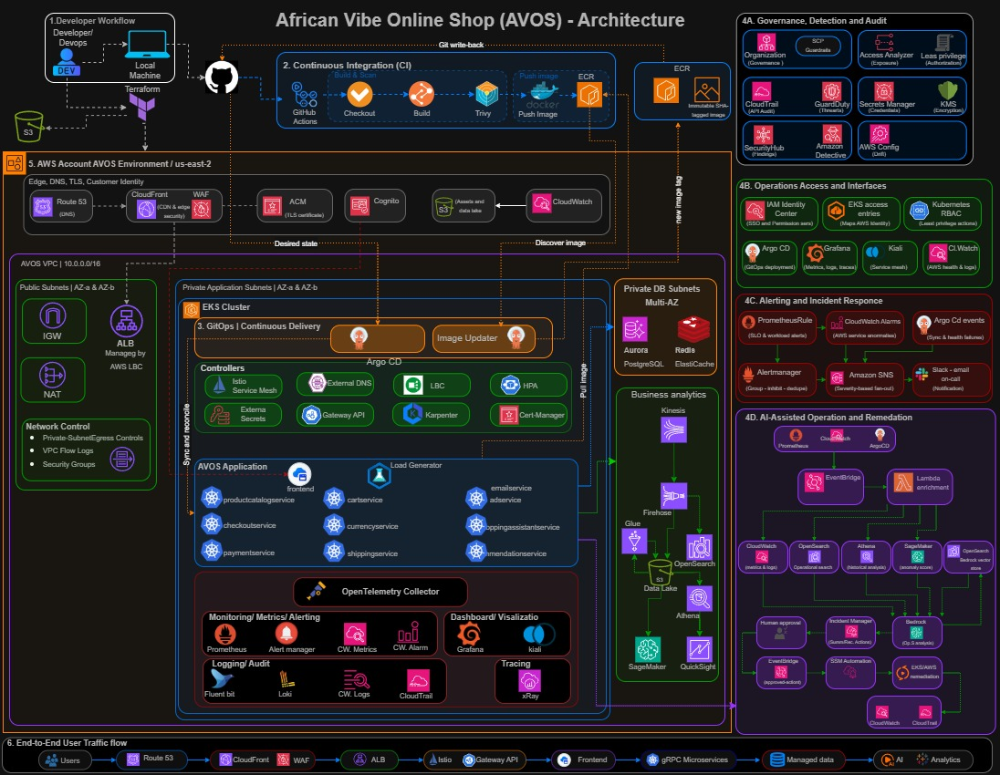
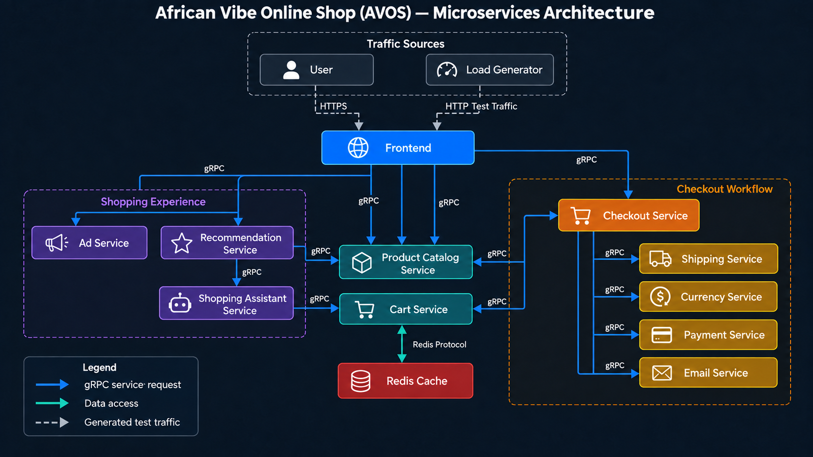
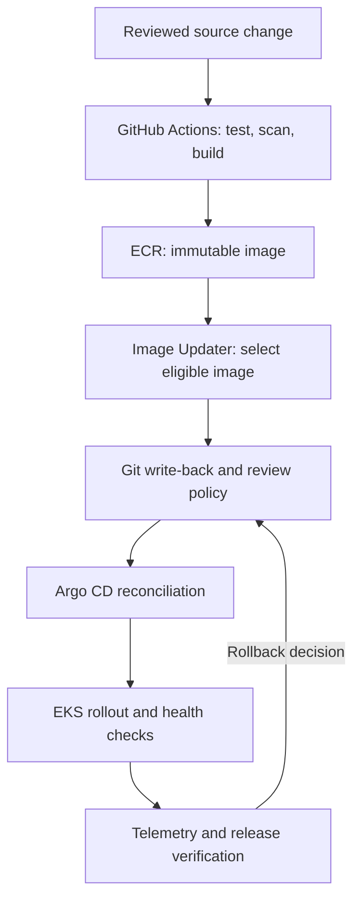
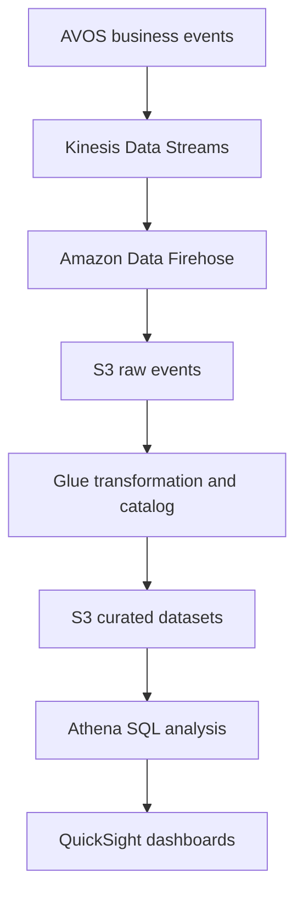

<!-- README.md | African Vibe Online Shop (AVOS) | Phase 14 completed-state portfolio edition -->

# African Vibe Online Shop (AVOS)

## AI-Enhanced, GitOps-Driven E-Commerce Platform on AWS


African Vibe Online Shop (AVOS) is a cloud-native e-commerce portfolio platform built on Amazon Web Services. It combines polyglot microservices, modular Terraform infrastructure, Kubernetes, secure gRPC communication, automated container delivery, GitOps, observability, business analytics, and AI-assisted operations.

The project demonstrates the complete engineering lifecycle: establishing cloud foundations, deploying applications, securing traffic and identities, operating workloads, investigating failures, recovering services, and controlling infrastructure costs.

> **Project milestone: Phase 14 complete.** The implementation spans the application baseline, AWS foundation, EKS platform, CI/CD, security, observability, managed data, analytics, AI integration, and operational handoff.
>
> AVOS is a portfolio implementation using production-oriented engineering practices. Payment authorization and email delivery are simulated application functions.

## Table of Contents

- [Engineering Outcomes](#engineering-outcomes)
- [Project Architecture](#project-architecture)
- [Microservices Architecture](#microservices-architecture)
- [Infrastructure and Platform](#infrastructure-and-platform)
- [CI/CD and GitOps](#cicd-and-gitops)
- [Security and Governance](#security-and-governance)
- [Observability and Incident Response](#observability-and-incident-response)
- [Reliability, Scaling, and Recovery](#reliability-scaling-and-recovery)
- [Analytics and AI](#analytics-and-ai)
- [Repository Structure](#repository-structure)
- [Getting Started](#getting-started)
- [Operational Commands](#operational-commands)
- [Development and Validation Commands](#development-and-validation-commands)
- [Project Documentation](#project-documentation)
- [License and Attribution](#license-and-attribution)

## Engineering Outcomes

| Area | Delivered capability |
|---|---|
| Application engineering | Independently buildable services in Go, C#, Node.js, Python, and Java, with typed gRPC contracts and non-root containers. |
| Infrastructure as Code | Modular Terraform for remote state, identity, governance, networking, EKS, and supporting AWS services. |
| Platform engineering | Private application workloads, Kubernetes controllers, secret synchronization, ingress, service mesh, and autoscaling. |
| Software delivery | Tested and scanned immutable images published to ECR, selected by Image Updater, and deployed through Argo CD. |
| DevSecOps | Federated access, short-lived pipeline credentials, least-privilege workload identities, admission policies, encryption, and audit controls. |
| Site reliability | Metrics, logs, traces, dashboards, alerts, resilience controls, load testing, rollback, and recovery procedures. |
| Data engineering | Managed persistence, event ingestion, an S3 data lake, curated datasets, SQL analysis, and business dashboards. |
| AI integration | Grounded shopping assistance and evidence-based operational recommendations with approval-controlled remediation. |
| Operational handoff | Architecture decisions, phase validation records, troubleshooting documentation, and repeatable operating procedures. |

## Project Architecture



Customer requests resolve through Route 53 and reach CloudFront, where ACM certificates provide HTTPS and AWS WAF evaluates incoming requests. CloudFront forwards origin requests to a public Application Load Balancer. The ALB routes traffic to the Istio ingress gateway, where Gateway API resources direct requests to the frontend in Amazon EKS.

The frontend coordinates backend gRPC requests. Application workloads run in private subnets, while managed data services use restricted network access. Telemetry, business events, and AI workflows follow separate paths with purpose-specific permissions.

CloudFront cache and origin request policies distinguish cacheable assets from personalized shopping traffic. Cart, checkout, and authenticated responses require policies that preserve customer isolation and application correctness.

**Architecture boundaries:**

- Terraform owns AWS infrastructure and the platform bootstrap resources assigned to it.
- Argo CD owns the Kubernetes resources assigned to its Applications.
- Image Updater owns automated GitOps image-reference changes.
- Human operators approve infrastructure changes, release promotions where required, and AI-assisted remediation.

Each resource has one declared management owner to prevent conflicting reconciliation.

## Microservices Architecture

AVOS includes **11 business microservices**, **one load-testing workload**, and **a Redis cart datastore dependency**.



| Component | Language | Responsibility |
|---|---|---|
| [`frontend`](src/frontend) | Go | Serves the storefront and coordinates backend requests. |
| [`productcatalogservice`](src/productcatalogservice) | Go | Lists, searches, and retrieves product information. |
| [`cartservice`](src/cartservice) | C# | Stores and retrieves customer cart contents using Redis. |
| [`checkoutservice`](src/checkoutservice) | Go | Orchestrates pricing, payment, shipping, cart cleanup, and confirmation. |
| [`currencyservice`](src/currencyservice) | Node.js | Converts prices between supported currencies. |
| [`paymentservice`](src/paymentservice) | Node.js | Simulates payment authorization and returns transaction identifiers. |
| [`shippingservice`](src/shippingservice) | Go | Calculates shipping costs and generates tracking information. |
| [`emailservice`](src/emailservice) | Python | Simulates order-confirmation delivery. |
| [`recommendationservice`](src/recommendationservice) | Python | Recommends products using shopping context. |
| [`adservice`](src/adservice) | Java | Returns contextual advertisements. |
| [`shoppingassistantservice`](src/shoppingassistantservice) | Python | Supports conversational product discovery with grounded retrieval. |
| [`loadgenerator`](src/loadgenerator) | Python/Locust | Exercises storefront journeys for smoke, performance, and resilience testing. |

The [interactive gRPC dependency map](Docs/Architectures/avos-grpc-service-dependency-map.html) provides a service-level view. Download the HTML file and open it locally to use its interactive controls.

### Communication and data ownership

- Customers reach the storefront over HTTPS; internal load tests can use the frontend's HTTP service endpoint.
- Business services communicate through typed gRPC interfaces, with Istio providing mesh traffic security and telemetry.
- Cart Service connects to Redis using the Redis protocol.
- Aurora PostgreSQL stores durable commerce data; ElastiCache for Redis holds cart state; S3 stores assets and analytical datasets.
- Business events flow asynchronously to analytics so reporting does not sit on the synchronous checkout path.
- Health probes and telemetry endpoints serve operational purposes and remain separate from business APIs.

## Infrastructure and Platform

| Layer | Components | Implementation role |
|---|---|---|
| Terraform foundation | Amazon S3, KMS, state locking | Protects remote state and coordinates infrastructure changes. |
| Identity and governance | IAM Identity Center, Organizations, SCPs, IAM | Provides federated administration and account guardrails. |
| Network | VPC, public/private subnet tiers, route tables, IGW, NAT, VPC endpoints, Flow Logs | Separates ingress, application, and data access across availability zones. |
| Edge | Route 53, CloudFront, ACM, AWS WAF | Provides DNS, TLS, content delivery, request filtering, and security headers. |
| Customer identity | Amazon Cognito | Authenticates customers and issues tokens for protected application flows. |
| Compute | Amazon EKS, managed node groups, Karpenter | Separates baseline platform capacity from demand-driven workload capacity. |
| Kubernetes networking | AWS Load Balancer Controller, Istio, Gateway API | Connects the ALB to application routing and mesh policy. |
| DNS and certificates | ExternalDNS, cert-manager | Automates scoped DNS records and in-cluster certificate workflows. |
| Secrets | Secrets Manager, External Secrets Operator, EKS Pod Identity | Supplies runtime secrets through workload-specific AWS permissions. |
| Scaling | Metrics Server, HPA, Karpenter | Connects workload metrics, replica scaling, and node provisioning. |
| Managed data | Aurora PostgreSQL, ElastiCache for Redis, S3 | Separates durable records, transient cart state, and object storage. |
| Search | Amazon OpenSearch Service | Supports scoped search and vector retrieval indexes. |

ACM manages certificates used by AWS edge and load-balancing services. cert-manager manages certificates within its Kubernetes scope. Their responsibilities follow the relevant TLS termination boundary.

## CI/CD and GitOps

AVOS separates artifact production, image selection, and deployment reconciliation.

| Component | Ownership |
|---|---|
| GitHub Actions | Runs service checks, tests, security scans, container builds, and ECR publication using GitHub OIDC. |
| Amazon ECR | Stores service images identified by immutable commit-based tags. |
| Argo CD Image Updater | Discovers eligible images and writes selected image references to a Git branch under configured policy. |
| Git review and branch controls | Govern which configuration changes reach the deployment branch. |
| Argo CD | Renders and reconciles the approved Git configuration into EKS, reporting synchronization and health. |



Image Updater is the single automated writer for GitOps image references. GitHub Actions publishes images; a deployment proceeds when the corresponding desired-state change reaches the branch watched by Argo CD.

Rollback restores the approved image reference in Git. Operators coordinate rollback with Image Updater policy so a rejected image is not immediately selected again. Database compatibility is considered separately from application image rollback.

## Security and Governance

| Control domain | Controls |
|---|---|
| Human access | IAM Identity Center, scoped permission sets, EKS access entries, and Kubernetes RBAC. |
| Pipeline identity | GitHub OIDC and scoped AWS roles with short-lived sessions. |
| Workload identity | EKS Pod Identity and service-account-specific permissions. |
| Edge protection | WAF managed rules, rate-based rules, TLS, CloudFront security headers, and Shield Standard. |
| Network isolation | Private workload/data subnets, security groups, network policies, and VPC Flow Logs. |
| Service traffic | Istio mTLS and service authorization policies. |
| Secret management | Secrets Manager and External Secrets Operator; secret values remain outside Git. |
| Workload policy | Kyverno admission controls, non-root containers, and restricted workload permissions. |
| Supply chain | Trivy scanning, ECR scanning, reviewed workflows, and protected release controls. |
| Encryption | KMS-backed encryption for supported state, storage, logs, secrets, and data services. |
| Audit and detection | CloudTrail, Config, GuardDuty, Security Hub, and IAM Access Analyzer. |
| Account governance | AWS Organizations and SCP guardrails. |

Operational dashboards and administrative interfaces use controlled access. Public storefront access does not grant access to Argo CD, Grafana, Kiali, or the Kubernetes API.

## Observability and Incident Response

| Signal | Components | Operational use |
|---|---|---|
| Metrics | Prometheus, kube-state-metrics, CloudWatch Metrics | Tracks request rates, errors, latency, resource pressure, and AWS health. |
| Dashboards | Grafana | Correlates application, cluster, capacity, and service-level indicators. |
| Logs | Fluent Bit, Loki, CloudWatch Logs | Centralizes workload and AWS logs for investigation. |
| Traces | OpenTelemetry Collector, AWS X-Ray | Follows requests across frontend and gRPC dependencies. |
| Mesh topology | Kiali | Exposes traffic relationships, failure patterns, and mesh security state. |
| Workload alerts | PrometheusRule, Alertmanager | Evaluates thresholds, groups alerts, and routes actionable notifications. |
| AWS alerts | CloudWatch Alarms, EventBridge, SNS | Detects infrastructure failures and delivers severity-based notifications. |
| Response | Slack/email integrations, dashboards, ownership, runbooks | Connects an alert to an accountable responder and recovery procedure. |

Incident investigation starts with the customer symptom, then follows the request path: edge, ingress, frontend, downstream services, and data dependencies. Responders correlate alert timing with deployments, pod events, logs, traces, and infrastructure changes before choosing a recovery action.

## Reliability, Scaling, and Recovery

AVOS combines workload resilience with documented operating procedures:

- Readiness, liveness, and startup probes control traffic admission and restart behavior.
- Resource requests and limits support scheduling and capacity planning.
- PodDisruptionBudgets protect eligible replicated workloads during voluntary disruptions.
- Topology spread distributes replicas across nodes and availability zones where capacity permits.
- HPA adjusts application replicas; Karpenter provisions suitable nodes for pending workloads and consolidates capacity under configured limits.
- Service deadlines, bounded retries, and traffic policies limit cascading failures; retries are restricted to operations that can safely tolerate them.
- Git history and immutable images support deployment rollback.
- Database backups, restore procedures, and infrastructure recreation support recovery.
- Development pause, resume, and cleanup procedures reduce idle cost while preserving required state and recovery material.

Load testing exercises browsing, product detail, currency selection, cart actions, and checkout. Smoke-test reporting records **nonzero requests, zero failures, and whether checkout was exercised**. Scaling validation separately examines replica changes, pending pods, node provisioning, workload readiness, and scale-down behavior.

A controller reporting Ready establishes configuration health. Workload-driven scaling requires observations from an actual load or scheduling test. Recovery records similarly capture restore results rather than treating backup configuration alone as proof of recoverability.

## Analytics and AI

### Business analytics

Customer and commerce events feed an asynchronous analytics pipeline.



S3 separates raw, curated, failed, and query-result data. Glue manages catalog metadata and transformations; Athena queries the resulting datasets; QuickSight presents business views. OpenSearch supports search-oriented access, while SageMaker supports analytical and anomaly-detection workloads within the AI scope.

### Shopping assistant

The shopping assistant combines Amazon Bedrock, Guardrails, and OpenSearch vector retrieval to produce responses grounded in approved product information. Access controls scope retrieval and model invocation. Runtime credentials and configuration follow the platform's secret-management boundaries.

### AI-assisted operations

Operational context includes CloudWatch, Prometheus, Loki, X-Ray, Argo CD, Athena, and available anomaly signals. EventBridge and Lambda gather relevant evidence; Bedrock summarizes the incident and proposes a response.

A human reviews the recommendation before an approved action invokes an allow-listed SSM Automation runbook. Execution uses scoped permissions and records approval, execution, and outcome for audit and follow-up.

AI output does not independently authorize infrastructure changes. Remediation follows deterministic procedures with defined preconditions, rollback steps, and post-action health checks.

## Repository Structure

```text
African-Vibe-Online-Shop-AVOS/
├── .github/                    # CI workflows, ownership, and review controls
├── Docs/
│   ├── ADR/                    # Architecture decisions and tradeoffs
│   ├── Architectures/          # Platform and service dependency diagrams
│   ├── Phase-validation/       # Validation evidence organized by phase
│   └── Roadmap/                # Implementation sequence and acceptance gates
├── src/
│   ├── frontend/
│   ├── adservice/
│   ├── cartservice/
│   ├── checkoutservice/
│   ├── currencyservice/
│   ├── emailservice/
│   ├── paymentservice/
│   ├── productcatalogservice/
│   ├── recommendationservice/
│   ├── shippingservice/
│   ├── shoppingassistantservice/
│   └── loadgenerator/
├── gitops/                     # Argo CD configuration and desired workload state
├── terraform/                  # Infrastructure modules and environment configuration
├── .gitignore
├── LICENSE
└── README.md
```

CloudHustler provides historical engineering context. AVOS maintains its own resource identity, configuration, documentation, and validation records.

## Getting Started

Commands below use **Bash syntax**, including Git Bash on Windows. Install Git, AWS CLI v2, Terraform, kubectl, Helm, Docker, and the language runtimes required by the services you work on. Use the versions pinned in repository configuration where supplied.

### Clone the repository

```bash
git clone https://github.com/Gabinsime75/African-Vibe-Online-Shop-AVOS.git
cd African-Vibe-Online-Shop-AVOS
git status --short
```

Review the [roadmap](Docs/Roadmap/AVOS-IMPLEMENTATION-ROADMAP.md), [architecture decisions](Docs/ADR/README.md), and environment configuration before provisioning infrastructure. Follow the documented dependency order for bootstrap, identity/governance, networking, EKS, controllers, and application services.

### Authenticate and configure EKS access

These examples use the AVOS development profile, region, and cluster. The AWS SSO profile must already be configured, and your identity must have EKS and Kubernetes permissions.

```bash
aws sso login --profile avos-admin

aws sts get-caller-identity \
  --profile avos-admin

aws eks update-kubeconfig \
  --name avos-dev-eks \
  --region us-east-2 \
  --profile avos-admin

kubectl config current-context
kubectl get nodes -o wide
kubectl get namespaces
```

Confirm the context before running commands that change resources. If authentication expires, renew the SSO session. If the API is unreachable, inspect endpoint access settings and the approved network path.

## Operational Commands

### Inspect application and controller health

```bash
# Application workloads and recent scheduling/runtime events.
kubectl get deployments,pods,services -n avos-dev
kubectl get events -n avos-dev --sort-by=.metadata.creationTimestamp

# AWS Load Balancer Controller health.
kubectl get deployment aws-load-balancer-controller -n kube-system
kubectl logs -n kube-system \
  deployment/aws-load-balancer-controller --tail=100

# Controller namespaces and installed Helm releases.
kubectl get pods -A
helm list -A

# Gateway API routing and ingress status.
kubectl get gateways,httproutes -A
```

### Inspect GitOps delivery

```bash
# Argo CD components, Applications, and image-selection configuration.
kubectl get pods -n argocd
kubectl get applications.argoproj.io -n argocd
kubectl get imageupdaters.argocd-image-updater.argoproj.io -n argocd

# Frontend desired-state configuration and image update policy.
kubectl get application avos-dev-frontend -n argocd -o yaml
kubectl get imageupdater avos-dev -n argocd -o yaml

# Fetch and list Image Updater write-back branches.
git fetch origin
git branch -r --list 'origin/image-updater/dev-*'
```

Inspect the Application's target revision, synchronization status, health, and image reference together. An ECR image publication alone does not establish that the application deployed it.

### Inspect autoscaling

```bash
# Metrics Server must be healthy for resource-metric output.
kubectl top nodes
kubectl top pods -n avos-dev
kubectl get hpa -n avos-dev

# Karpenter configuration and provisioned capacity.
kubectl get nodepools
kubectl get ec2nodeclasses
kubectl get nodeclaims
kubectl get nodes -o wide
```

Compare these observations before, during, and after a controlled load test. Check configured resource limits and cost controls before increasing test traffic.

### Review load-test results

```bash
# Locate the current smoke-test Job.
kubectl get jobs -n avos-dev --sort-by=.metadata.creationTimestamp

# Enter the exact Job name returned above.
read -r -p 'Smoke-test Job name: ' smoke_job
kubectl wait -n avos-dev \
  --for=condition=complete "job/$smoke_job" --timeout=180s
kubectl logs -n avos-dev "job/$smoke_job" --all-containers=true
```

Check request statistics, failure counts, and the `/cart/checkout` entry. Job completion is only one part of acceptance; inspect application errors and test assertions as well.

### Inspect AWS alerting

```bash
aws sns list-topics \
  --profile avos-admin \
  --region us-east-2 \
  --query 'Topics[].TopicArn' \
  --output table

aws cloudwatch describe-alarms \
  --profile avos-admin \
  --region us-east-2 \
  --state-value ALARM \
  --query 'MetricAlarms[].{Name:AlarmName,Reason:StateReason}' \
  --output table
```

## Development and Validation Commands

### Terraform

Run these commands from the documented Terraform environment root after supplying its required backend and variable configuration. Review the plan before applying it.

```bash
terraform fmt -check -recursive
terraform init
terraform validate
terraform plan -detailed-exitcode
plan_status=$?
printf 'Terraform plan exit code: %s\n' "$plan_status"
```

With `-detailed-exitcode`, `0` means no changes, `1` means an error, and `2` means proposed changes. A no-change plan establishes configuration convergence at that checkpoint; application health requires separate checks.

### Service checks

Run each group from the corresponding service directory with its dependencies installed. Check the service's own documentation for required environment variables and integration-test dependencies.

```bash
# Go services: frontend, catalog, checkout, and shipping.
go test ./...
go build ./...
```

```bash
# Node.js services: currency and payment.
npm ci
npm run check
npm test
```

```bash
# Python services: use the service's documented virtual environment.
python -m unittest discover -p 'test_*.py' -v
python -m compileall -q .
```

```bash
# C# cart service: run from the directory containing its project/solution.
dotnet restore
dotnet build --no-restore
dotnet test --no-build
```

```bash
# Java ad service.
./gradlew clean test --no-daemon
```

### Repository hygiene and configuration discovery

Run from the repository root. `rg` commands require ripgrep.

```bash
git diff --check
git diff --cached --check

# Locate infrastructure and GitOps configuration files.
rg --files terraform gitops

# Find alerting configuration and roadmap responsibilities.
rg -n -i 'platform-alerting|Alertmanager|Amazon SNS|drift' \
  terraform gitops Docs/Roadmap
```

Keep Terraform state, saved plans, credentials, local secret files, and generated build output outside version control. Validate rendered Kubernetes configuration and complete the required CI checks before merging changes.

## Project Documentation

| Resource | Purpose |
|---|---|
| [Implementation roadmap](Docs/Roadmap/AVOS-IMPLEMENTATION-ROADMAP.md) | Phase sequence, dependencies, acceptance gates, and closeout responsibilities. |
| [Architecture decisions](Docs/ADR/README.md) | Design decisions, alternatives, and operational tradeoffs. |
| [Phase validation records](Docs/Phase-validation/) | Commands, outputs, test observations, and implementation evidence. |
| [Project architecture](Docs/Architectures/avos-project-architecture.jpg) | AWS platform, delivery, governance, observability, analytics, and AI relationships. |
| [Microservices architecture](Docs/Architectures/avos-microservices-architecture.png) | Application dependencies and communication protocols. |
| [Interactive dependency map](Docs/Architectures/avos-grpc-service-dependency-map.html) | Downloadable service-dependency exploration. |
| [Service source](src/) | Application code, service-specific checks, and runtime dependencies. |
| [Infrastructure](terraform/) | Terraform modules and environment-specific infrastructure configuration. |
| [GitOps configuration](gitops/) | Argo CD desired state and automated image-selection configuration. |

Phase records and operational documentation provide the detailed evidence behind the platform overview. Version pins, resource sizing, environment identifiers, and deployment inputs remain in their owning configuration files.

## License and Attribution

AVOS preserves applicable upstream copyright and license notices inherited with source files. Product rebranding retains third-party attribution obligations.

See [`LICENSE`](LICENSE) and individual source-file notices for applicable terms.
